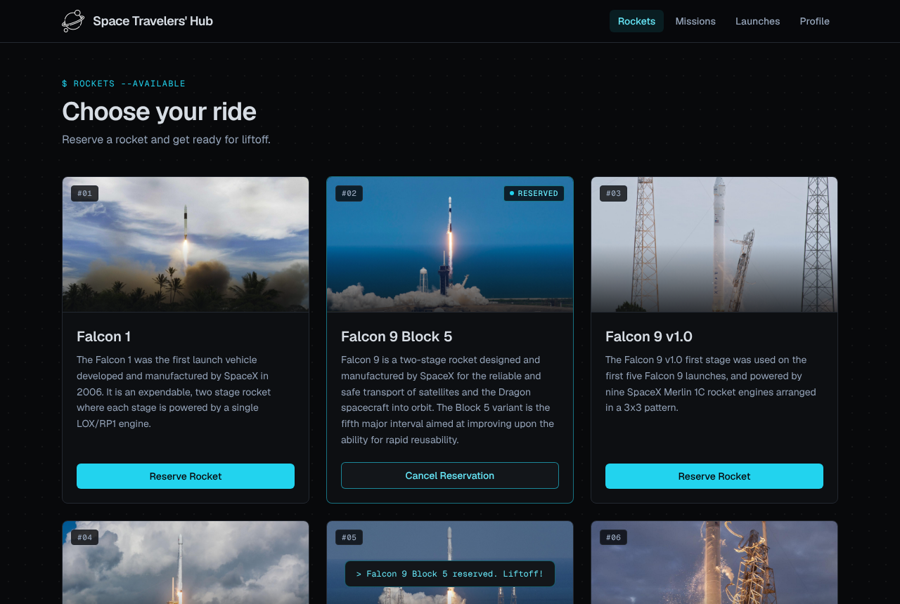
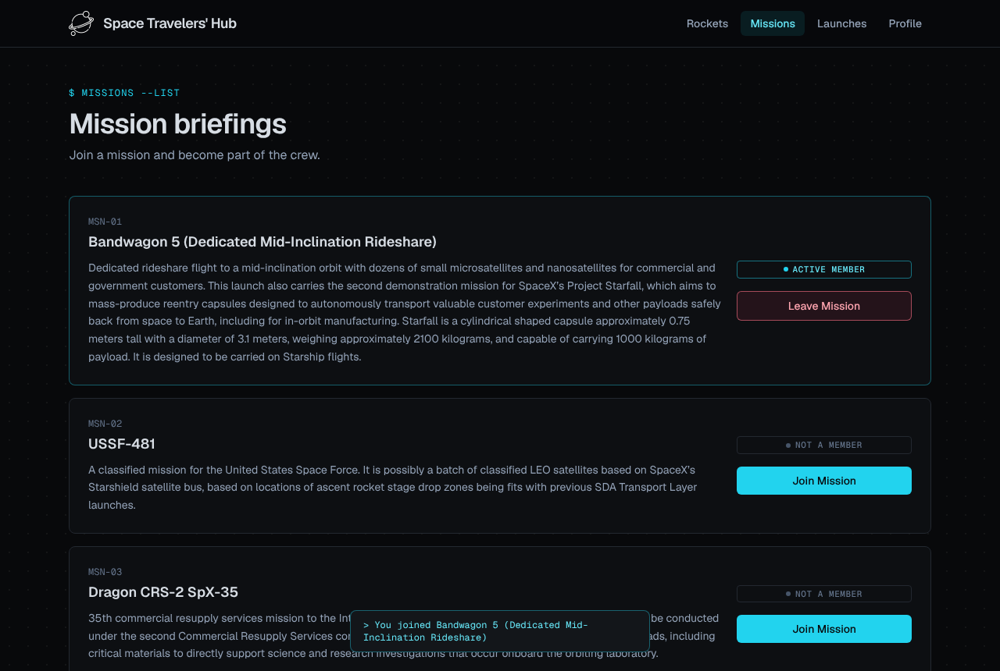
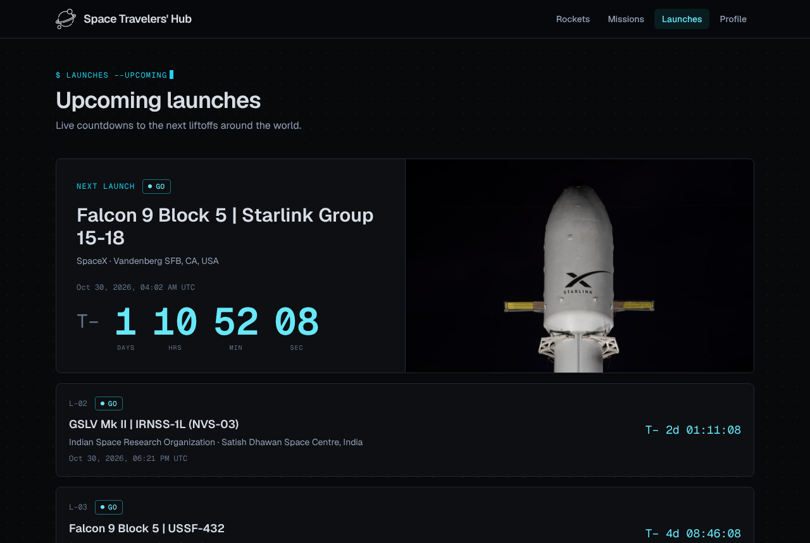
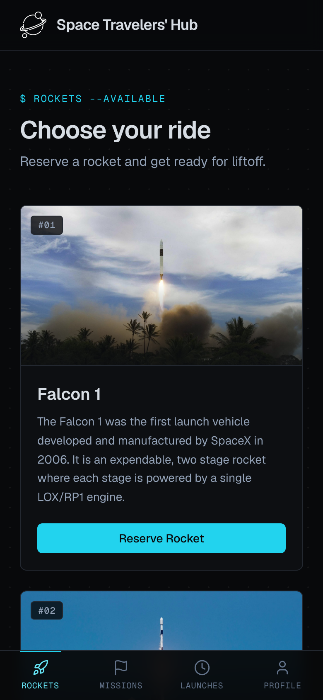

# Space Travelers' Hub

> A dark, console-styled React + Redux app for reserving rockets, joining space missions, and counting down to the next launches.

[**Live Demo**](https://spacehubnazirandkai.netlify.app/)



<p align="center">
  
  
</p>

<p align="center">
  
</p>

> Screenshots use sample data. Rocket and mission text come from the SpaceX API.

## Features

- **Reserve rockets** and **join missions**, with a launch animation and toast feedback.
- **Reservations persist** across page reloads (saved in `localStorage`).
- **Upcoming launches** page with a live ticking countdown to the next liftoff.
- **Resilient data loading**: skeleton loaders while fetching, and a "Signal lost" retry screen if an API call fails.
- **Responsive**: a card grid on desktop and an icon bottom navigation on mobile.
- **Accessible details**: real image alt text, visible keyboard focus, and animations that respect `prefers-reduced-motion`.

## Built With

- [React](https://react.dev/) 18 and React Router 6
- [Redux](https://redux.js.org/) with `redux-thunk` for async data
- [Vite](https://vitejs.dev/) for the dev server and build
- [Tailwind CSS](https://tailwindcss.com/) with design tokens in `tailwind.config.js`
- [Geist Sans and Geist Mono](https://vercel.com/font) (Sans for text, Mono for labels, IDs and status tags)
- Data: [SpaceX API v3](https://github.com/r-spacex/SpaceX-API) (rockets, missions) and [Launch Library 2](https://thespacedevs.com/llapi) (upcoming launches)

## Getting Started

**Prerequisites:** Node.js 18+ and npm.

```bash
git clone https://github.com/AhmedNazirMusah/Space-Travelers-Hub.git
cd Space-Travelers-Hub
npm install
npm start
```

The app runs at [http://localhost:3000](http://localhost:3000).

### Scripts

| Command         | What it does                      |
| --------------- | --------------------------------- |
| `npm start`     | Start the Vite dev server         |
| `npm run build` | Create a production build (`dist/`) |
| `npm run preview` | Preview the production build    |

### Linting

```bash
npx eslint src --ext .js,.jsx
npx stylelint "src/**/*.css"
```

## Deployment

Deployed on [Vercel](https://vercel.com/): import the repo and the Vite preset is detected automatically (build command `npm run build`, output `dist`). `vercel.json` rewrites all routes to `index.html` so React Router pages work on refresh.

## Project Structure

```
src/
├── components/        # Pages and UI (navbar, rockets, missions, launches, toast...)
└── redux/
    ├── rockets/       # Rockets slice and thunk
    ├── missions/      # Missions slice and thunk
    ├── launches/      # Upcoming launches slice, thunk and 10-minute cache
    ├── status/        # Per-resource loading / failed state
    └── storage.js     # Safe localStorage helpers
```

## Notes

- The launches API has a free-tier rate limit (about 15 requests per hour), so responses are cached for 10 minutes.
- The SpaceX v3 API is no longer actively updated, so the rockets and missions data is static.

## Authors

👤 **Ahmed Nazir Musa**

- GitHub: [@AhmedNazirMusa](https://github.com/AhmedNazirMusa)

👤 **Paul Kaizirege Vedasto**

- GitHub: [@kaizipaul](https://github.com/kaizipaul)

Built as a pair-programming project, then redesigned with a dark console theme, persistence, error handling and a launches page.

## 🤝 Contributing

Contributions, issues, and feature requests are welcome!

Feel free to check the [issues page](../../issues/).

## Show your support

Give a ⭐️ if you like this project!

## Acknowledgments

- Microverse Inc.
- [SpaceX API](https://github.com/r-spacex/SpaceX-API) and [The Space Devs](https://thespacedevs.com/)

## 📝 License

This project is [MIT](./LICENSE) licensed.